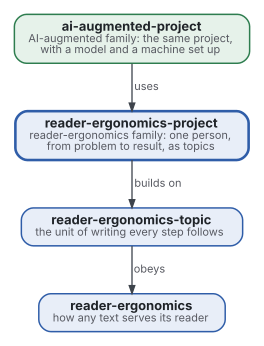
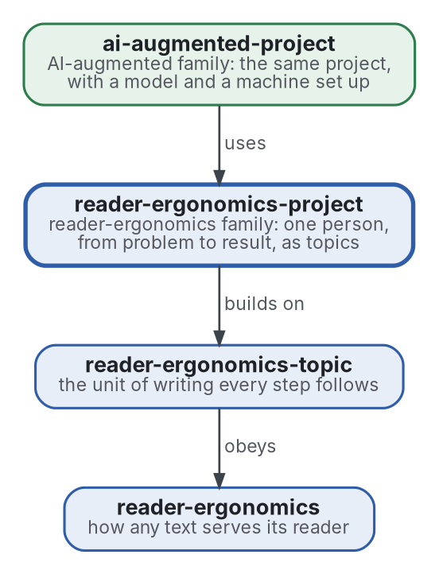

# Projet

[](https://github.com/Tewf/reader-ergonomics-project/actions/workflows/checks.yml)
[](https://tewf.github.io/reader-ergonomics-project/)

Comment une personne prépare et mène un **projet**, du problème au résultat, avec le moins d'allers-retours. Les
étapes sont le périmètre, la revue de littérature, la référence, le plan, l'exécution et son affinage, chacune écrite
comme un topic. Le dossier qu'un travail laisse derrière lui en fait partie, pour qu'une autre personne le reprenne. Le raisonnement d'un
projet est le sujet ; les documents qu'il produit relèvent des genres.

Cette page en anglais : [README.md](README.md). Les deux versions suivent le même état.

> **État (2026-11-02) :** la première passe de la revue de littérature est écrite : 38 sources, cinq étapes, une
> référence nommée. La [forme du projet](shapes/project.md) est écrite, avec un exemple rempli et une vérification (décision 0003). Le nom reste, pour la raison de la décision 0002.
> Ce n'est ni une norme officielle, ni une étude relue par des pairs, ni un résultat nouveau.
>
> **Comment il est fait :** avec Claude, un assistant IA d'Anthropic, sous la direction du mainteneur, comme
> reader-ergonomics. Les corrections sont bienvenues sous forme d'issues.

## Où il se place



<details>
<summary>Graphviz source</summary>



</details>

- **Il s'appuie sur le [topic](https://github.com/Tewf/reader-ergonomics-topic/blob/86e14fe9a1a9877d6a87a2f8b4e8713f98724b5a/shapes/topic.md)** (reader-ergonomics-topic v0.6.1) : chaque étape d'un
  projet est un topic, avec son titre, son résumé et ses parties.
- **Il obéit à [reader-ergonomics](https://github.com/Tewf/reader-ergonomics/blob/b9732b9814c71768f722691f3c5049ec2b8ed378/standard.md)** (v1.19.2) et exécute ses vérifications en CI.
- **Il ne pointe que vers le bas.** Les deux sont épinglés par commit ; aucun ne pointe vers ce dépôt. Son pendant avec
  un modèle dans la boucle est [ai-augmented-project](https://github.com/Tewf/ai-augmented-project), un niveau au-dessus.
- **La famille qu'il reflète** est cartographiée dans [ai-augmented](https://github.com/Tewf/ai-augmented) ; le pont entre les deux est
  [reader-ergonomics-blueprint](https://github.com/Tewf/reader-ergonomics-blueprint), le topic avec un vérificateur sur chaque partie.

## Périmètre

| | Quoi | Pourquoi |
|---|---|---|
| dedans | les étapes du problème au résultat : périmètre, revue, référence, plan, exécution, affinage | tout projet les répète, quel que soit son genre |
| dedans | chaque étape écrite comme un topic : une affirmation, son résumé, ses parties | la personne ne se perd pas, et un lecteur suit le raisonnement |
| dedans | ce qui réduit les allers-retours : ce qui est décidé avant de commencer, ce qui revient à la personne, quand la référence est nommée | le coût d'un projet, c'est surtout le travail refait |
| dedans | le dossier qu'un travail laisse : ce qui a été demandé, trouvé, produit, et où cela vit | une seconde personne, ou la même plus tard, reprend à partir de là |
| dehors | l'écriture d'un document donné : rapport, conception, exposé, preuve | la [famille reader-ergonomics](https://github.com/Tewf/reader-ergonomics/blob/b9732b9814c71768f722691f3c5049ec2b8ed378/extending.md) tient la forme de chaque genre |
| dehors | le document de conception et la fiche de décision | [reader-ergonomics-software-design](https://github.com/Tewf/reader-ergonomics-software-design) les tient ; ce dépôt les lie quand une étape en a besoin |
| dehors | un modèle de langue ou une machine dans la boucle | [ai-augmented-project](https://github.com/Tewf/ai-augmented-project) |

## Le premier travail : une revue de littérature

Une première passe est faite, dans [evidence/project-method](evidence/project-method/). Elle suit l'ordre d'une revue de thèse, et elle est finie quand elle peut nommer la référence.

1. **Cadrer :** le problème en une phrase, et comment chaque domaine le nomme. La revue n'a trouvé aucun nom
   unique, donc le dépôt garde le sien.
2. **Revue :** chaque nom ci-dessous, cherché par son nom académique, son acronyme et son auteur ; les synthèses d'abord.
   - la recherche en science de la conception (design science) et ses modèles de processus ;
   - la méthodologie de la recherche : comment une thèse est cadrée, revue et positionnée avant toute construction ;
   - les heuristiques de résolution de problèmes, Polya d'abord ;
   - les cadres de projet et de processus, lus comme littérature grise : ce qu'ils prescrivent, ce qui a été mesuré ;
   - le travail refait et ses causes dans les projets logiciels et de recherche ;
   - ce que reader-ergonomics tient déjà : la vue d'ensemble d'abord, le plan peu profond, la fiche de décision.
3. **État de l'art, et le dossier contre.**
4. **Positionnement :** ce que ce dépôt demande et que le domaine ne répond pas déjà.
5. **Référence :** la méthode que le mainteneur suit déjà, écrite, comparée au meilleur processus trouvé par la revue.

## Ce que la revue a trouvé

Une première passe de 38 sources, 33 formelles et 5 grises ; seize œuvres formelles sont localisées, non ouvertes ([protocole](evidence/project-method/protocol.md)).

- **Aucune étape n'est mesurée.** Aucune source n'isole un périmètre écrit, une référence nommée ou une liste des décisions
  de la personne et ne mesure le travail refait. Ce sont des conventions, non testées ([revue](evidence/project-method/review.md)).
- **Une cause majeure du travail refait évitable est la spécification hâtive.** Un rapport d'experts chiffre le travail refait évitable à 40 à
  50 pour cent de l'effort. Il nomme des exigences spécifiées à la hâte comme source majeure (Boehm 2001). Menzies 2017 ne trouve aucun effet du retard sur 171 projets : un coût fixe de
  100 fois pour un défaut tardif n'est pas étayé ([contre](evidence/project-method/against.md)).
- **Le processus de la science de la conception n'a pas d'étape de revue.** Il nomme des objectifs et une
  évaluation contre eux. Une cible de comparaison s'y trouve, mais aucune activité de revue de littérature (Peffers 2006).
- **La trace est une pratique sans test.** Les guides s'accordent sur un README, un dossier par projet et un journal daté
  (Noble 2009 ; Wilson 2017). Aucune étude ne teste qu'une seconde personne puisse reprendre à partir d'eux.
- **La méthode finit là où le genre commence.** Le processus se termine par la communication ; la forme d'un document
  lui est extérieure ([positionnement](evidence/project-method/position.md)).

Les réponses aux quatre questions sont dans [la revue](evidence/project-method/review.md).

## La référence

**B1** est les six activités du processus de recherche en science de la conception (Peffers 2006) pour les étapes, et
l'organisation de projet de Noble 2009 et Wilson 2017 pour la trace. La pratique du mainteneur, écrite pour cette revue,
lui est comparée par des travaux appariés : allers-retours, travail refait et questions d'une seconde personne. La
comparaison est nommée, non menée ([référence](evidence/project-method/baseline.md)).

## Questions auxquelles la revue doit répondre

- **Allers-retours.** Quelles étapes, écrites avant le début du travail, réduisent le travail refait de façon mesurée :
  le périmètre, la référence, la liste des décisions qui reviennent à la personne ?
- **Topics.** Écrire le périmètre et le plan en topics change-t-il le résultat, ou seulement la lecture ?
- **La trace.** Que doit laisser un travail pour qu'une seconde personne le reprenne sans demander ? Quatre fichiers
  sont la réponse actuelle du mainteneur : la demande, les notes, la production, les pointeurs.
- **La frontière.** Où la méthode s'arrête-t-elle et où commencent les formes des genres ? Un plan est un topic ; un
  document de conception appartient à software-design.

## Vérifier

```sh
git clone https://github.com/Tewf/reader-ergonomics
python3 reader-ergonomics/checks/run.py chemin/vers/ce/depot
```

La CI exécute les mêmes vérifications à chaque push, et une exécution échoue à la première erreur
([checks.yml](https://github.com/Tewf/reader-ergonomics-project/blob/master/.github/workflows/checks.yml)). Chaque push
sur master construit aussi le site, [tewf.github.io/reader-ergonomics-project](https://tewf.github.io/reader-ergonomics-project/)
([pages.yml](https://github.com/Tewf/reader-ergonomics-project/blob/master/.github/workflows/pages.yml)).

## Contenu

| Partie | Résumé |
|---|---|
| [evidence](evidence/) | la revue derrière ce dépôt : une première passe sur la méthode d'un projet, et la bibliographie |
| [shapes](shapes/) | la forme du projet : six topics du problème au résultat, un exemple rempli, et la vérification qui les lit |
| [decisions](decisions/) | une fiche par choix qui façonne ce dépôt, chacune ouvrant sur la décision en une phrase |

## Licence

Code sous [Apache License 2.0](LICENSE) ; prose sous [CC BY 4.0](LICENSES/CC-BY-4.0.txt). Réutilisez-le comme vous le
souhaitez, en créditant ce dépôt ; [CITATION.cff](CITATION.cff) donne une citation si besoin.
