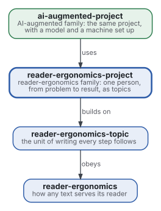
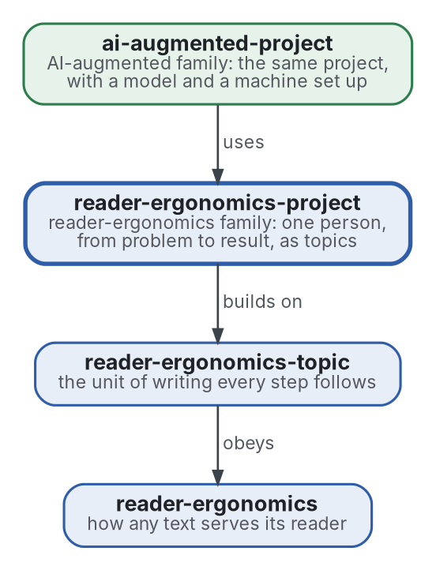

# Project

[](https://github.com/Tewf/reader-ergonomics-project/actions/workflows/checks.yml)
[](https://tewf.github.io/reader-ergonomics-project/)

How one person prepares and runs a **project**, from a problem to its result, with the fewest round trips. The steps
are the scope, the literature review, the baseline, the plan, the execution and its refinement, each written as a
topic. The folder a job leaves behind is part of it, so that someone else can resume the work. The reasoning of a project is the subject; the
documents it produces belong to the genres.

This page in French: [README.fr.md](README.fr.md).

> **Status (2026-11-02):** set up; nothing is written yet beyond the scope. The first job is a literature review, not
> started. The name is provisional until that review's first step says what the field calls this. It is not an
> official standard, not a peer-reviewed study and not a new result.
>
> **How it is made:** with Claude, an AI assistant by Anthropic, under the maintainer's direction, the way
> reader-ergonomics was made. Corrections are welcome as issues.

## Where it sits



<details>
<summary>Graphviz source</summary>



</details>

- **It builds on the [topic](https://github.com/Tewf/reader-ergonomics-topic/blob/86e14fe9a1a9877d6a87a2f8b4e8713f98724b5a/shapes/topic.md)** (reader-ergonomics-topic v0.6.1): every step of a
  project is a topic, with its title, its summary and its parts.
- **It obeys [reader-ergonomics](https://github.com/Tewf/reader-ergonomics/blob/b9732b9814c71768f722691f3c5049ec2b8ed378/standard.md)** (v1.19.2) and runs its checks in CI.
- **It links down only.** Both are pinned by commit; neither links up to this repository. Its counterpart with a model
  in the loop is [ai-augmented-project](https://github.com/Tewf/ai-augmented-project), one level above.

## Scope

| | What | Why |
|---|---|---|
| in | the steps from a problem to its result: scope, review, baseline, plan, execution, refinement | they are what every project repeats, whatever its genre |
| in | each step written as a topic: one claim, its summary, its parts | the person does not get lost, and a reader can follow the reasoning |
| in | what cuts round trips: what is decided before starting, what is the person's to decide, when the baseline is named | the cost of a project is mostly the work redone |
| in | the folder a job leaves behind: what was asked, what was found, what was produced, where it lives | a second person, or the same one later, resumes from it |
| out | the writing of any one document: a report, a design, a talk, a proof | the [reader-ergonomics family](https://github.com/Tewf/reader-ergonomics/blob/b9732b9814c71768f722691f3c5049ec2b8ed378/extending.md) holds each genre's shape |
| out | the design document and the decision record | [reader-ergonomics-software-design](https://github.com/Tewf/reader-ergonomics-software-design) holds them; this links them where a step needs one |
| out | a language model or a machine in the loop | [ai-augmented-project](https://github.com/Tewf/ai-augmented-project) |

## The first job: a literature review

Not started. It follows the order of a thesis review, and it is finished when it can name the baseline.

1. **Frame:** the problem in one sentence, and what each field calls it. The repository may be renamed then; GitHub
   redirects the old address.
2. **Review:** each name below, searched by its academic name, its acronym and its author; surveys first.
   - design science research, and its process models;
   - research methodology: how a thesis is framed, reviewed and positioned before anything is built;
   - heuristics for solving problems, Polya first;
   - project and process frameworks, read as grey literature: what they prescribe, what was measured;
   - rework and its causes in software and research projects;
   - what reader-ergonomics already holds: overview first, the shallow outline, the decision record.
3. **State of the art, and the case against.**
4. **Position:** what this repository asks that the field does not already answer.
5. **Baseline:** the method the maintainer already follows, written down, compared with the best process the review
   found.

## Questions the review must answer

- **Round trips.** Which steps, when written before the work starts, are measured to cut rework: the scope, the
  baseline, the list of decisions that are the person's?
- **Topics.** Does writing the scope and the plan as topics change the outcome, or only the reading?
- **The trail.** What must a job leave behind for a second person to resume it without asking? Four files are the
  maintainer's current answer: the brief, the notes, the output, the pointers.
- **The boundary.** Where does the method stop and the genre shapes begin? A plan is a topic; a design document is
  software-design's.

## Check it

```sh
git clone https://github.com/Tewf/reader-ergonomics
python3 reader-ergonomics/checks/run.py path/to/this/repository
```

CI runs the same checks on every push, and a run fails on any error
([checks.yml](https://github.com/Tewf/reader-ergonomics-project/blob/master/.github/workflows/checks.yml)). Every push
to master also renders the site, [tewf.github.io/reader-ergonomics-project](https://tewf.github.io/reader-ergonomics-project/)
([pages.yml](https://github.com/Tewf/reader-ergonomics-project/blob/master/.github/workflows/pages.yml)).

## Contents

| Part | Summary |
|---|---|
| [decisions](decisions/) | one record per choice that shapes this repository, each opening with the decision in one sentence |

## Licence

Code under the [Apache License 2.0](LICENSE); prose under [CC BY 4.0](LICENSES/CC-BY-4.0.txt). Reuse it as you wish,
with credit to this repository; [CITATION.cff](CITATION.cff) gives a citation if you need one.
